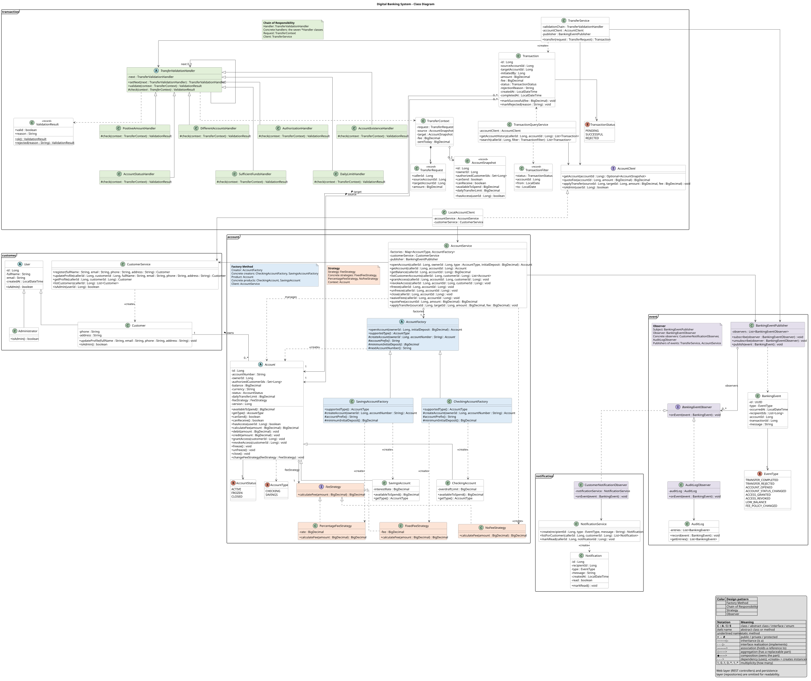
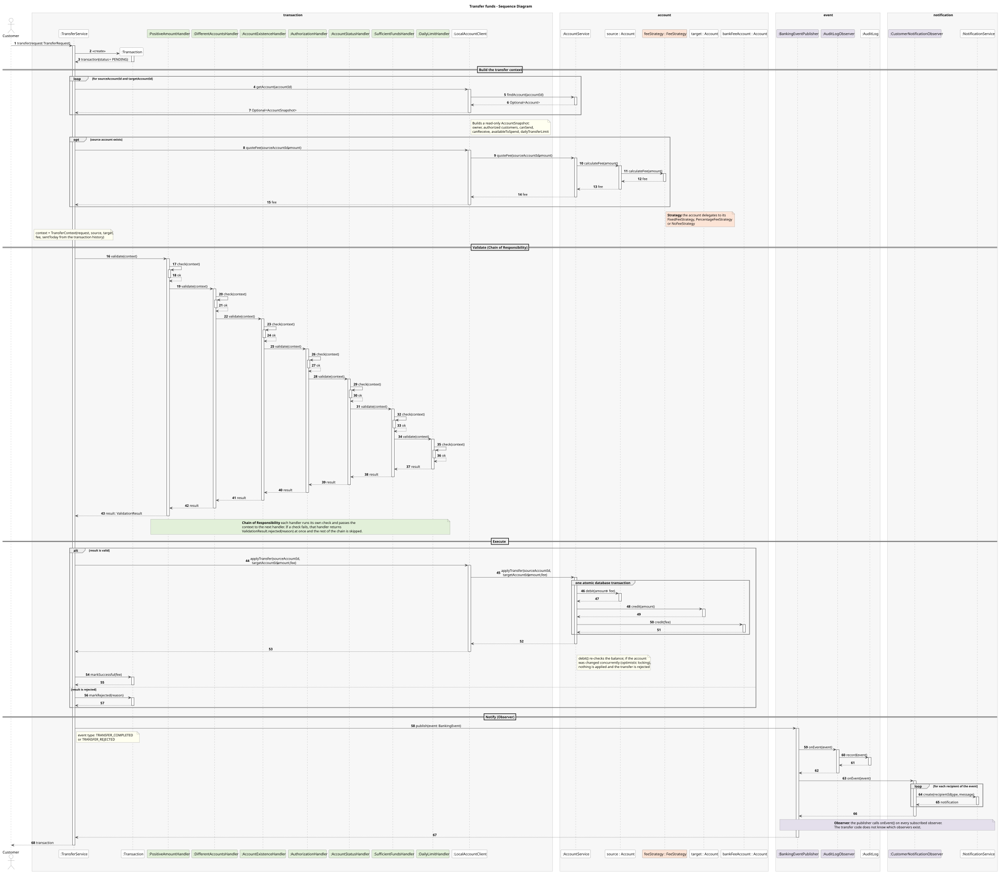
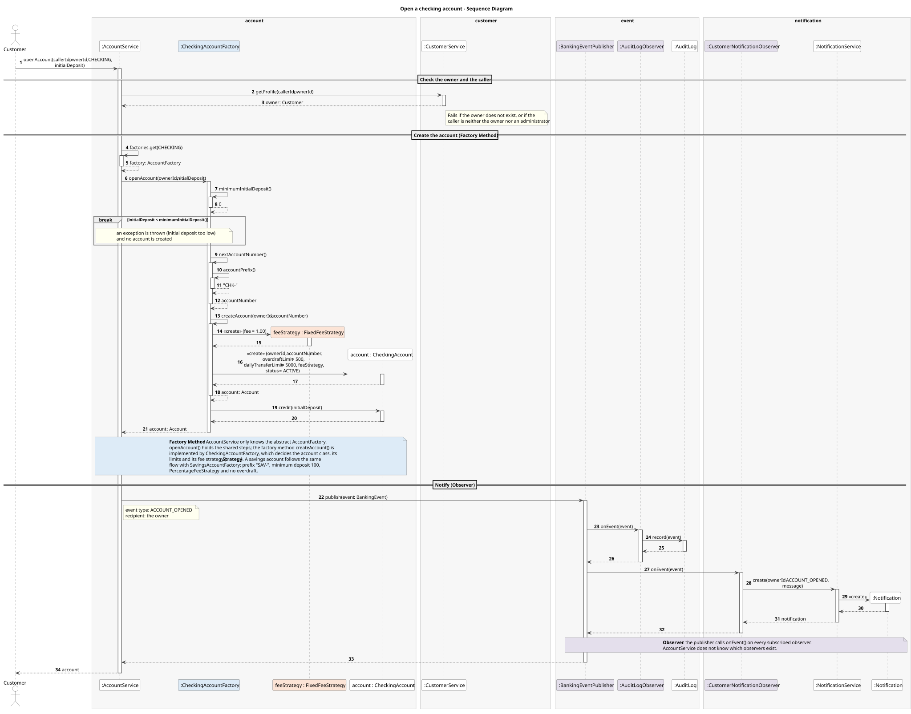
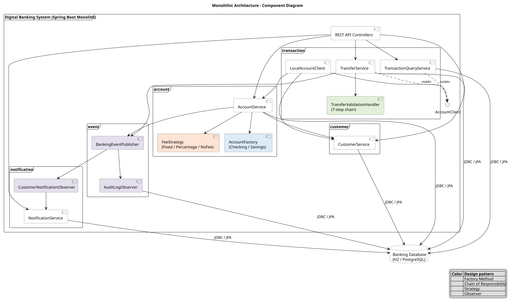
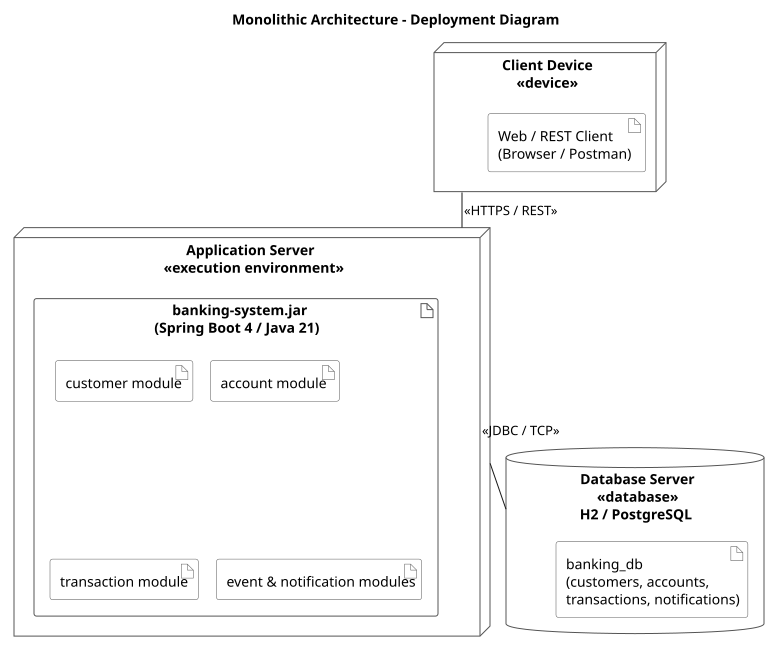
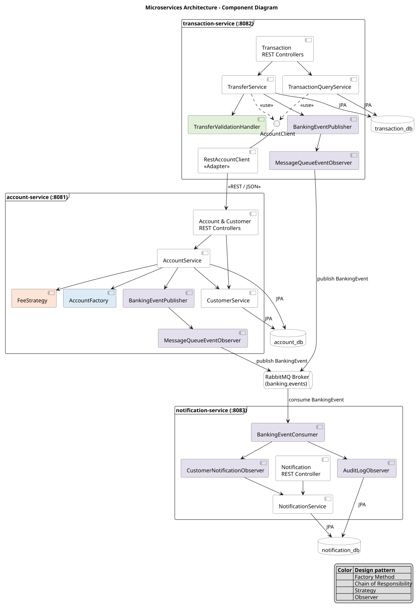
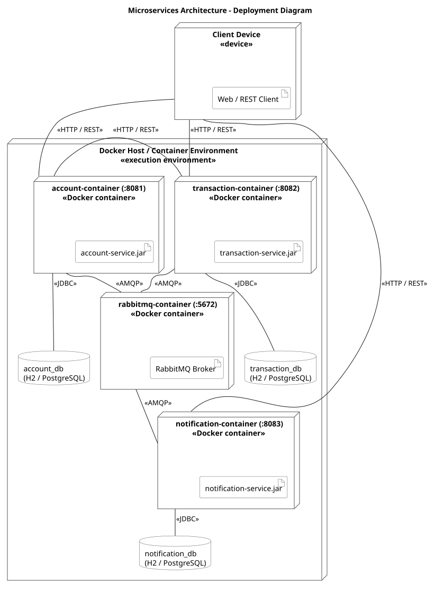
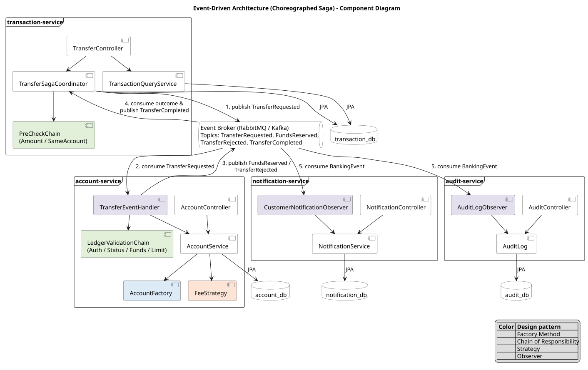
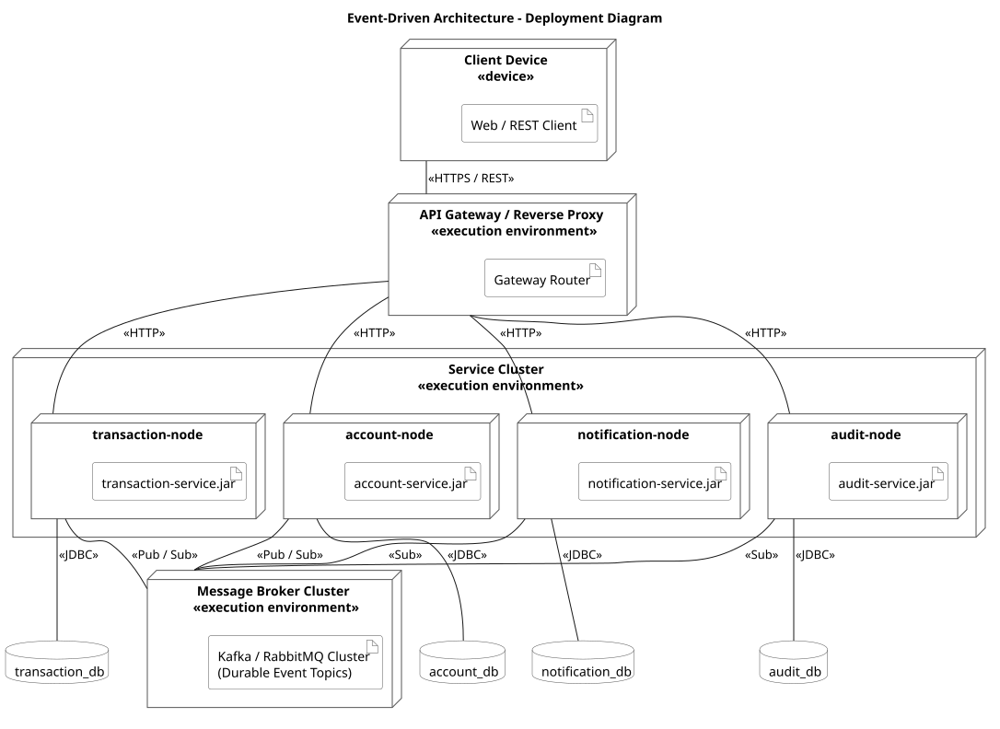

# Digital Banking System

SDT team project: a simplified Digital Banking System where customers manage bank accounts, transfer funds, view their transaction history and receive notifications, while administrators manage accounts and monitor transactions.

### Functionalities

| Area | Features |
|------|----------|
| **Customer Management** | Create and manage customer profiles Associate customers with one or more bank accounts Manage account access |
| **Account Management** | Create and manage bank accounts View account balances View account details and status |
| **Transaction Management** | Transfer funds between accounts Validate available balances before transactions Maintain transaction history |
| **Transaction Status and Monitoring** | Track pending, successful, and rejected transactions Allow administrators to inspect transactions Maintain consistent account balances after transactions |
| **Notifications** | Notify customers about completed transactions Notify users about failed transactions or important account activity |

### Team

| # | Name | Group |
|---|------|-------|
| 1 | KISELAR Vladyslav | 1241EB |
| 2 | BASIUK Yelyzaveta | 1241EB |
| 3 | KUCHERENKO Illia | 1241EB |

### Table of contents

1. [TASK 1. Design patterns](#task-1-design-patterns)
2. [TASK 2. Justification of the design patterns](#task-2-justification-of-the-design-patterns)
   - [Factory Method](#factory-method)
   - [Chain of Responsibility](#chain-of-responsibility)
   - [Strategy](#strategy)
   - [Observer](#observer)
   - [How the patterns work together](#how-the-patterns-work-together)
3. [TASK 3. UML class diagram](#task-3-uml-class-diagram)
4. [TASK 4. UML sequence diagrams](#task-4-uml-sequence-diagrams)
   - [Transfer funds](#transfer-funds)
   - [Open an account](#open-an-account)

---

## TASK 1. Design patterns

| # | Pattern | Category | Where it is used | Functionality served |
|---|---------|----------|------------------|----------------------|
| 1 | [**Factory Method**](#factory-method) | Creational | Creating bank accounts of different types (`CheckingAccount`, `SavingsAccount`) | Account Management, Customer Management |
| 2 | [**Chain of Responsibility**](#chain-of-responsibility) | Behavioral | Validating a transfer through a sequence of independent checks | Transaction Management, Customer Management |
| 3 | [**Strategy**](#strategy) | Behavioral | Calculating the transfer fee according to the rules of the source account | Transaction Management |
| 4 | [**Observer**](#observer) | Behavioral | Reacting to transaction and account events (customer notifications, audit log) | Notifications |

---

## TASK 2. Justification of the design patterns

### Factory Method

**Problem.** Opening an account involves more than calling a constructor. Each account type needs its own account number format, its own settings (overdraft limit for checking, interest rate for savings, daily transfer limit) and its own fee strategy. If this setup code is written wherever an account is created, it gets duplicated, and every place has to know about every account type.

**Solution.** `AccountFactory` declares the factory method `createAccount()`, and each concrete factory (`CheckingAccountFactory`, `SavingsAccountFactory`) builds one account type completely and correctly: account number, type-specific limits and the fee strategy the account will use. The rest of the system asks for an account of a given type and receives a ready-to-use `Account`, without knowing which class was instantiated or how it was configured.

| Simpler alternative | Factory Method |
|---------------------|----------------|
| A `switch` on the account type with `new CheckingAccount(...)` / `new SavingsAccount(...)` and setup code | Each account type has one factory that contains all its creation rules |
| Adding a new account type means editing every `switch` that creates accounts | Adding a new account type means adding a new factory; existing code does not change |
| Callers depend on concrete account classes | Callers depend only on `Account` and `AccountFactory` |

### Chain of Responsibility

**Problem.** A transfer must pass several independent checks before any money moves: amount, account existence, authorization, account status, sufficient funds and the daily limit. Banking rules also change over time, so checks are added, removed or reordered.

**Solution.** Each check is a separate handler with a single responsibility. A handler either rejects the transfer with a specific reason or passes it to the next handler. The chain is assembled once, and the transfer service only calls its first handler.

| Step | Check |
|:----:|-------|
| 1 | The amount is positive |
| 2 | Source and target accounts are different |
| 3 | Both accounts exist |
| 4 | The customer is authorized to use the source account |
| 5 | The source account can send and the target account can receive (not frozen or closed) |
| 6 | The source account has sufficient funds to cover the amount plus the fee, according to its own rules |
| 7 | The daily transfer limit of the source account is not exceeded |

| Simpler alternative | Chain of Responsibility |
|---------------------|-------------------------|
| One long validation method with a sequence of `if` statements | Each check is a small class that can be read and tested on its own |
| Adding or reordering a rule means editing that method, risking the other checks | Adding a rule means adding a handler; reordering means changing how the chain is assembled |
| The transfer service is coupled to every validation rule | The transfer service only knows the first handler of the chain |

### Strategy

**Problem.** Transfer fees depend on the source account: a fixed amount for checking accounts, a percentage for savings accounts, or no fee at all when an administrator waives the fees. The fee is needed in two places, when checking that the balance is sufficient and when charging it, and new fee policies may be introduced later.

**Solution.** `FeeStrategy` defines the fee calculation, and each policy is a separate implementation. Every account receives its strategy when it is created and delegates the calculation to it, so the transfer logic simply asks the account for its fee.

| Strategy | Used by | Fee |
|----------|---------|-----|
| `FixedFeeStrategy` | `CheckingAccount` | A fixed amount per transfer |
| `PercentageFeeStrategy` | `SavingsAccount` | A percentage of the transferred amount |
| `NoFeeStrategy` | Accounts whose fees were waived by an administrator | None |

| Simpler alternative | Strategy |
|---------------------|----------|
| `if (type == CHECKING) ... else if (type == SAVINGS) ...` wherever a fee is calculated | The fee calculation exists once per policy, in its own class |
| A new fee policy means finding and editing every fee `if` | A new fee policy means adding a new strategy class |
| The fee policy is fixed by the account type in code | The policy can be replaced at runtime, for example when an administrator waives the fees of an account |

### Observer

**Problem.** Several parts of the system must react to the same events. When a transfer is completed or rejected, the customer must be notified and the operation must be recorded in the audit log. Account events, such as an account being frozen, need the same reactions. More reactions will follow, such as forwarding events to the notification service through a message queue.

**Solution.** A `BankingEventPublisher` keeps a list of `BankingEventObserver`s and notifies all of them when an event occurs. The services that perform transfers and manage accounts only publish events; each observer decides on its own how to react.

| Event source | Events |
|--------------|--------|
| Transactions | Transfer completed, transfer rejected |
| Accounts | Account opened, frozen, unfrozen or closed; access granted or revoked; fees waived; balance below a threshold |

| Simpler alternative | Observer |
|---------------------|----------|
| The transfer service calls the email sender, the audit log and every other reaction directly | The transfer service only publishes an event and does not know who reacts |
| A new reaction means editing the transfer and account services | A new reaction means adding a new observer class |
| A failing notification can break the transfer that triggered it | Each observer is isolated; a failing observer does not stop the transfer or the other observers |
| Moving notifications to a separate service means rewriting every call | Moving notifications to a separate service means adding one observer that sends events to the message queue |

### How the patterns work together

The factories create each account together with its rules and its fee strategy. During a transfer, the chain of responsibility validates the request, using the source account's fee strategy to check that the balance covers the amount plus the fee. If all checks pass, the amount and the fee are applied and the transaction is marked as successful; otherwise it is marked as rejected. In both cases the observers are notified of the result.

> **Factory Method** ➜ **Chain of Responsibility** ➜ **Strategy** ➜ **Observer**

---

## TASK 3. UML class diagram

A single class diagram covers the whole system. The design patterns are integrated into it rather than drawn separately: the classes of each pattern share a color, and a note in the same color, placed in the pattern's package, names the role each class plays in the pattern.

| Package | Responsibility |
|---------|----------------|
| `customer` | Customers, administrators and their profiles |
| `account` | Bank accounts, account creation (Factory Method), transfer fees (Strategy), account access and status |
| `transaction` | Transfers, transfer validation (Chain of Responsibility), transaction history and monitoring |
| `event` | Publishing banking events to observers (Observer) and the audit log |
| `notification` | Customer notifications created from banking events |

The web layer (REST controllers) and the persistence layer (repositories) are omitted to keep the diagram readable.

PNG version: [class-diagram.png](docs/diagrams/class-diagram.png) · PlantUML source: [class-diagram.puml](docs/diagrams/class-diagram.puml)

---

## TASK 4. UML sequence diagrams

The two diagrams show the main use cases of the system. Together they show all four design patterns at runtime, using the same classes and methods as the class diagram. Participants are grouped by package and colored by pattern, as in the class diagram.

| Diagram | Use case | Patterns shown |
|---------|----------|----------------|
| [Transfer funds](#transfer-funds) | A customer transfers money from one account to another | Chain of Responsibility, Strategy, Observer |
| [Open an account](#open-an-account) | A customer opens a new checking account | Factory Method, Strategy, Observer |

### Transfer funds

`TransferService` creates a pending transaction and loads both accounts and the fee through `AccountClient`; the fee is calculated by the source account's fee strategy. The transfer then passes through all seven validation handlers. If it is valid, the debit, the credit and the fee are applied in one atomic operation and the transaction is marked as successful; otherwise it is marked as rejected. In both cases an event is published and the observers record it in the audit log and notify the customers.

PNG version: [sequence-transfer.png](docs/diagrams/sequence-transfer.png) · PlantUML source: [sequence-transfer.puml](docs/diagrams/sequence-transfer.puml)

### Open an account

`AccountService` checks the owner and the caller, then selects the factory for the requested account type. `CheckingAccountFactory` validates the initial deposit, generates the account number and, through the factory method `createAccount()`, creates the account together with its fee strategy. The initial deposit is credited, and an `ACCOUNT_OPENED` event notifies the owner and is recorded in the audit log.

PNG version: [sequence-open-account.png](docs/diagrams/sequence-open-account.png) · PlantUML source: [sequence-open-account.puml](docs/diagrams/sequence-open-account.puml)
---

## TASK 6. Software architectures

Three architectural styles are evaluated for the Digital Banking System using the domain packages and design patterns from Tasks 1–5.

### Monolithic architecture

**Structure and data flow.** All five domain packages (`customer`, `account`, `transaction`, `event`, `notification`) are packaged into a single Spring Boot application (`banking-system.jar`) backed by one relational database. REST controllers delegate to domain services inside the same JVM. During a transfer, `TransferService` calls `AccountService` synchronously in memory through `LocalAccountClient`. `AccountService.applyTransfer()` debits the source account, credits the target account, and credits the bank fee account inside one local ACID transaction (`@Transactional`) protected by optimistic locking (`@Version`). Events are dispatched synchronously in memory by `BankingEventPublisher` to `CustomerNotificationObserver` and `AuditLogObserver`.

PNG version: [arch-monolith-component.png](docs/diagrams/arch-monolith-component.png) · PlantUML source: [arch-monolith-component.puml](docs/diagrams/arch-monolith-component.puml)

PNG version: [arch-monolith-deployment.png](docs/diagrams/arch-monolith-deployment.png) · PlantUML source: [arch-monolith-deployment.puml](docs/diagrams/arch-monolith-deployment.puml)

| Pros | Cons |
|------|------|
| Strong ACID consistency for account balances in a single database transaction | Single point of failure: an unhandled failure or resource spike affects the whole system |
| Simple local development, end-to-end testing, and single-artifact deployment | Cannot scale high-volume read/transfer workloads independently from notifications |
| Zero network latency between transfer validation, balance updates, and notifications | Every change requires rebuilding and redeploying the entire application |

---

### Microservices architecture

**Structure and data flow.** The system is split along domain boundaries into three independently deployable Spring Boot services, each owning its own database (Database-per-Service):

- **`account-service` (port 8081):** owns `customer` and `account` data, account creation (**Factory Method**), fee calculation (**Strategy**), and atomic balance updates (`applyTransfer`).
- **`transaction-service` (port 8082):** owns `transaction` history, transfer validation (**Chain of Responsibility**), and admin inspection. It communicates synchronously over REST with `account-service` through `RestAccountClient` (an **Adapter** implementing `AccountClient`).
- **`notification-service` (port 8083):** owns `notification` persistence and customer alert queries.

For notifications and audit logging, `account-service` and `transaction-service` keep the in-memory `BankingEventPublisher` (**Observer**) and register a `MessageQueueEventObserver` that publishes `BankingEvent` messages to RabbitMQ, which `notification-service` consumes asynchronously.

PNG version: [arch-microservices-component.png](docs/diagrams/arch-microservices-component.png) · PlantUML source: [arch-microservices-component.puml](docs/diagrams/arch-microservices-component.puml)

PNG version: [arch-microservices-deployment.png](docs/diagrams/arch-microservices-deployment.png) · PlantUML source: [arch-microservices-deployment.puml](docs/diagrams/arch-microservices-deployment.puml)

| Pros | Cons |
|------|------|
| Fault isolation: if `notification-service` goes down, transfers still complete and queue in RabbitMQ | Higher operational overhead: three services, three databases, Docker networking, and a broker |
| Independent scaling of `transaction-service` and `account-service` under transfer load | Network latency and partial failure handling on REST calls between `transaction-service` and `account-service` |
| Clear service boundaries matching the `AccountClient` interface without rewriting domain logic | Integration and end-to-end testing require running multiple containers together |

---

### Event-driven architecture

**Structure and data flow.** Services have no direct synchronous REST calls between one another; all inter-service communication passes through a central message broker (RabbitMQ or Apache Kafka) using domain events. A fund transfer runs as a **choreographed saga**:

1. `transaction-service` creates a `PENDING` transaction, runs structural checks, and publishes `TransferRequested`.
2. `account-service` consumes `TransferRequested`, validates account status, funds, and daily limits, applies the debit/credit locally, and publishes `FundsReserved` or `TransferRejected`.
3. `transaction-service` consumes the outcome, marks the transaction `SUCCESSFUL` or `REJECTED`, and publishes `TransferCompleted`.
4. `notification-service` and `audit-service` consume the events independently to store alerts and audit entries.

PNG version: [arch-event-driven-component.png](docs/diagrams/arch-event-driven-component.png) · PlantUML source: [arch-event-driven-component.puml](docs/diagrams/arch-event-driven-component.puml)

PNG version: [arch-event-driven-deployment.png](docs/diagrams/arch-event-driven-deployment.png) · PlantUML source: [arch-event-driven-deployment.puml](docs/diagrams/arch-event-driven-deployment.puml)

| Pros | Cons |
|------|------|
| Maximum loose coupling: services only know event schemas, not each other's endpoints | Eventual consistency: clients see a `PENDING` status until the asynchronous saga finishes |
| Natural absorption of traffic spikes because the broker buffers incoming transfer requests | Complex failure recovery: multi-step sagas require idempotency keys, dead-letter queues, and compensating events |
| Easy extensibility: new consumers (e.g., fraud detection) subscribe without modifying existing services | Harder debugging and tracing across asynchronous event chains |

---

### Comparison of architectures

| Criterion | Monolithic | Microservices (REST + async events) | Event-driven (choreographed saga) |
|-----------|------------|-------------------------------------|-----------------------------------|
| **Implementation complexity** | Low (single codebase and database) | Moderate (3 services, REST client, broker) | High (saga state, idempotency, retries) |
| **Balance consistency** | Immediate (single local ACID transaction) | Immediate at ledger level (`applyTransfer` is atomic in `account-service`) | Eventual (multi-step async saga) |
| **Scalability** | Vertical / whole-app replication only | High (each service scales independently) | Very high (broker-buffered elastic consumers) |
| **Fault isolation** | Low (process-wide failure) | High (notification outages do not block transfers) | Very high (producers and consumers fully decoupled) |
| **Deployment and ops** | Single JAR and single database | Multiple containers + RabbitMQ + 3 DBs | Multiple containers + HA broker cluster + 4 DBs |
| **Testing** | Fast unit and single-context integration tests | Unit tests + contract/Docker Compose tests | Complex asynchronous integration testing |
| **Fit for a 3-person team** | Very good for PoC | Good balance of modularity and realism | Over-engineered for project scope |

---

### Selected architecture

**Microservices architecture with asynchronous events for notifications** is selected as the target architecture for the system (and implemented in Tasks 7–8).

1. **Immediate balance consistency where it matters:** In a banking system, concurrent transfers from the same account must never double-spend funds. Keeping `applyTransfer()` as a synchronous REST call to `account-service` executes the balance check, debit, credit, and `@Version` optimistic lock check inside one local database transaction, avoiding the complexity of compensating transactions in a full choreographed saga.
2. **Asynchronous decoupling for secondary workflows:** Notifications and audit logging do not need to block the transfer response. Publishing `BankingEvent` messages through `MessageQueueEventObserver` to RabbitMQ keeps `transaction-service` and `account-service` decoupled from `notification-service`.
3. **Clean evolution from the monolith:** Because `TransferService` already depends on the `AccountClient` interface and services already emit events via `BankingEventPublisher`, splitting the Task 5 monolith into `account-service`, `transaction-service`, and `notification-service` only requires swapping `LocalAccountClient` for `RestAccountClient` and adding `MessageQueueEventObserver`.