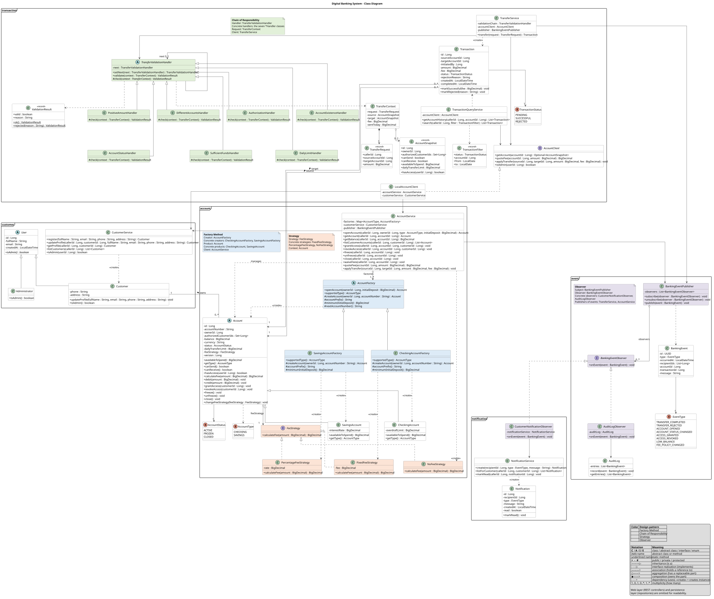
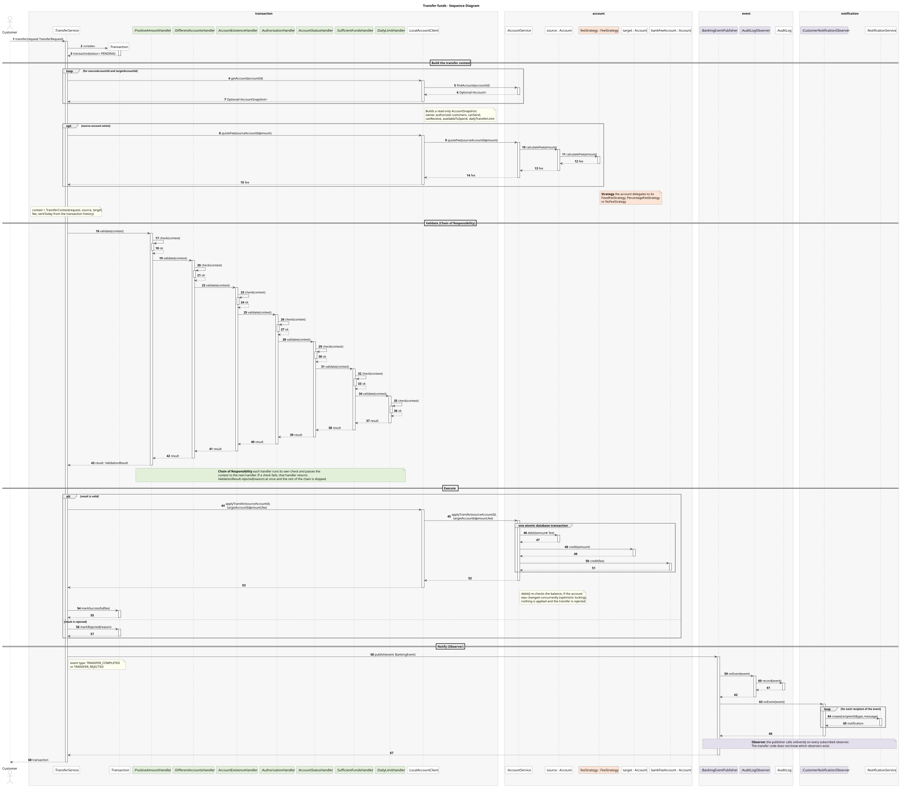
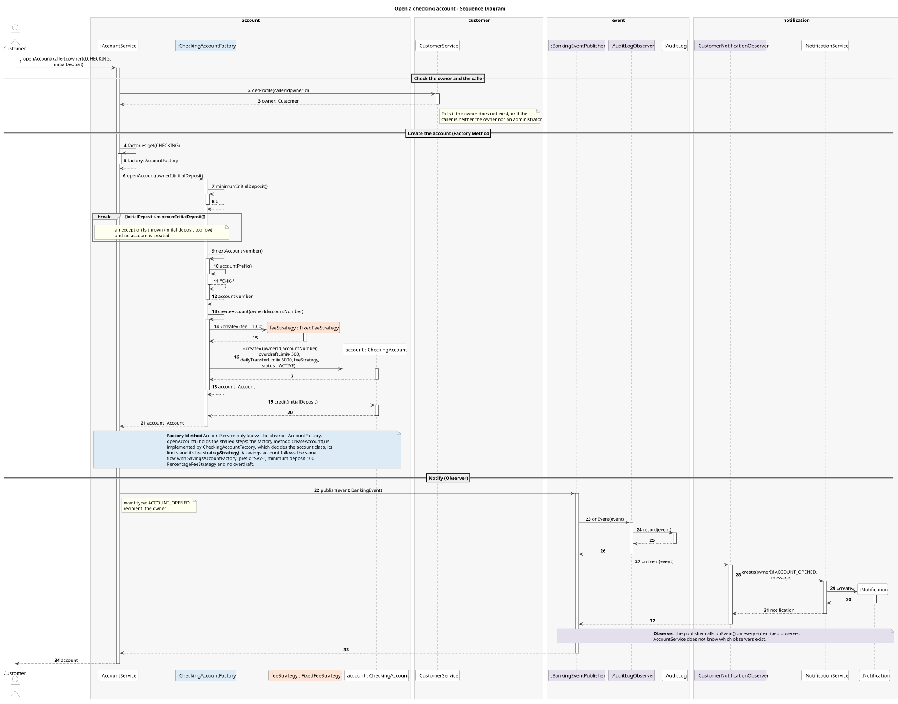

<div align="center">

# Digital Banking System

SDT team project: a simplified Digital Banking System where customers manage bank accounts, transfer funds, view their transaction history and receive notifications, while administrators manage accounts and monitor transactions.


</div>

### Functionalities

| Area | Features |
|------|----------|
| **Customer Management** | Create and manage customer profiles<br>Associate customers with one or more bank accounts<br>Manage account access |
| **Account Management** | Create and manage bank accounts<br>View account balances<br>View account details and status |
| **Transaction Management** | Transfer funds between accounts<br>Validate available balances before transactions<br>Maintain transaction history |
| **Transaction Status and Monitoring** | Track pending, successful, and rejected transactions<br>Allow administrators to inspect transactions<br>Maintain consistent account balances after transactions |
| **Notifications** | Notify customers about completed transactions<br>Notify users about failed transactions or important account activity |

### Team

| # | Name | Group |
|---|------|-------|
| 1 | KISELAR Vladyslav | 1241EB |
| 2 | BASIUK Yelyzaveta | 1241EB |
| 3 | KUCHERENKO Illia | 1241EB |

### Table of contents

1. [TASK 1. Design patterns](#task-1-design-patterns)
2. [TASK 2. Justification of the design patterns](#task-2-justification-of-the-design-patterns)
   - [Factory Method](#factory-method)
   - [Chain of Responsibility](#chain-of-responsibility)
   - [Strategy](#strategy)
   - [Observer](#observer)
   - [How the patterns work together](#how-the-patterns-work-together)
3. [TASK 3. UML class diagram](#task-3-uml-class-diagram)
4. [TASK 4. UML sequence diagrams](#task-4-uml-sequence-diagrams)
   - [Transfer funds](#transfer-funds)
   - [Open an account](#open-an-account)
5. [TASK 5. Proof of concept](#task-5-proof-of-concept)
   - [Design patterns implemented](#design-patterns-implemented)
   - [How to run the application and tests](#how-to-run-the-application-and-tests)
   - [Demo scenario](#demo-scenario)
   - [How the patterns work together in the code](#how-the-patterns-work-together-in-the-code)

---

## TASK 1. Design patterns

| # | Pattern | Category | Where it is used | Functionality served |
|---|---------|----------|------------------|----------------------|
| 1 | [**Factory Method**](#factory-method) | Creational | Creating bank accounts of different types (`CheckingAccount`, `SavingsAccount`) | Account Management, Customer Management |
| 2 | [**Chain of Responsibility**](#chain-of-responsibility) | Behavioral | Validating a transfer through a sequence of independent checks | Transaction Management, Customer Management |
| 3 | [**Strategy**](#strategy) | Behavioral | Calculating the transfer fee according to the rules of the source account | Transaction Management |
| 4 | [**Observer**](#observer) | Behavioral | Reacting to transaction and account events (customer notifications, audit log) | Notifications |

---

## TASK 2. Justification of the design patterns

### Factory Method

**Problem.** Opening an account involves more than calling a constructor. Each account type needs its own account number format, its own settings (overdraft limit for checking, interest rate for savings, daily transfer limit) and its own fee strategy. If this setup code is written wherever an account is created, it gets duplicated, and every place has to know about every account type.

**Solution.** `AccountFactory` declares the factory method `createAccount()`, and each concrete factory (`CheckingAccountFactory`, `SavingsAccountFactory`) builds one account type completely and correctly: account number, type-specific limits and the fee strategy the account will use. The rest of the system asks for an account of a given type and receives a ready-to-use `Account`, without knowing which class was instantiated or how it was configured.

| Simpler alternative | Factory Method |
|---------------------|----------------|
| A `switch` on the account type with `new CheckingAccount(...)` / `new SavingsAccount(...)` and setup code | Each account type has one factory that contains all its creation rules |
| Adding a new account type means editing every `switch` that creates accounts | Adding a new account type means adding a new factory; existing code does not change |
| Callers depend on concrete account classes | Callers depend only on `Account` and `AccountFactory` |

### Chain of Responsibility

**Problem.** A transfer must pass several independent checks before any money moves: amount, account existence, authorization, account status, sufficient funds and the daily limit. Banking rules also change over time, so checks are added, removed or reordered.

**Solution.** Each check is a separate handler with a single responsibility. A handler either rejects the transfer with a specific reason or passes it to the next handler. The chain is assembled once, and the transfer service only calls its first handler.

| Step | Check |
|:----:|-------|
| 1 | The amount is positive |
| 2 | Source and target accounts are different |
| 3 | Both accounts exist |
| 4 | The customer is authorized to use the source account |
| 5 | The source account can send and the target account can receive (not frozen or closed) |
| 6 | The source account has sufficient funds to cover the amount plus the fee, according to its own rules |
| 7 | The daily transfer limit of the source account is not exceeded |

| Simpler alternative | Chain of Responsibility |
|---------------------|-------------------------|
| One long validation method with a sequence of `if` statements | Each check is a small class that can be read and tested on its own |
| Adding or reordering a rule means editing that method, risking the other checks | Adding a rule means adding a handler; reordering means changing how the chain is assembled |
| The transfer service is coupled to every validation rule | The transfer service only knows the first handler of the chain |

### Strategy

**Problem.** Transfer fees depend on the source account: a fixed amount for checking accounts, a percentage for savings accounts, or no fee at all when an administrator waives the fees. The fee is needed in two places, when checking that the balance is sufficient and when charging it, and new fee policies may be introduced later.

**Solution.** `FeeStrategy` defines the fee calculation, and each policy is a separate implementation. Every account receives its strategy when it is created and delegates the calculation to it, so the transfer logic simply asks the account for its fee.

| Strategy | Used by | Fee |
|----------|---------|-----|
| `FixedFeeStrategy` | `CheckingAccount` | A fixed amount per transfer |
| `PercentageFeeStrategy` | `SavingsAccount` | A percentage of the transferred amount |
| `NoFeeStrategy` | Accounts whose fees were waived by an administrator | None |

| Simpler alternative | Strategy |
|---------------------|----------|
| `if (type == CHECKING) ... else if (type == SAVINGS) ...` wherever a fee is calculated | The fee calculation exists once per policy, in its own class |
| A new fee policy means finding and editing every fee `if` | A new fee policy means adding a new strategy class |
| The fee policy is fixed by the account type in code | The policy can be replaced at runtime, for example when an administrator waives the fees of an account |

### Observer

**Problem.** Several parts of the system must react to the same events. When a transfer is completed or rejected, the customer must be notified and the operation must be recorded in the audit log. Account events, such as an account being frozen, need the same reactions. More reactions will follow, such as forwarding events to the notification service through a message queue.

**Solution.** A `BankingEventPublisher` keeps a list of `BankingEventObserver`s and notifies all of them when an event occurs. The services that perform transfers and manage accounts only publish events; each observer decides on its own how to react.

| Event source | Events |
|--------------|--------|
| Transactions | Transfer completed, transfer rejected |
| Accounts | Account opened, frozen, unfrozen or closed; access granted or revoked; fees waived; balance below a threshold |

| Simpler alternative | Observer |
|---------------------|----------|
| The transfer service calls the email sender, the audit log and every other reaction directly | The transfer service only publishes an event and does not know who reacts |
| A new reaction means editing the transfer and account services | A new reaction means adding a new observer class |
| A failing notification can break the transfer that triggered it | Each observer is isolated; a failing observer does not stop the transfer or the other observers |
| Moving notifications to a separate service means rewriting every call | Moving notifications to a separate service means adding one observer that sends events to the message queue |

### How the patterns work together

The factories create each account together with its rules and its fee strategy. During a transfer, the chain of responsibility validates the request, using the source account's fee strategy to check that the balance covers the amount plus the fee. If all checks pass, the amount and the fee are applied and the transaction is marked as successful; otherwise it is marked as rejected. In both cases the observers are notified of the result.

> **Factory Method** ➜ **Chain of Responsibility** ➜ **Strategy** ➜ **Observer**

---

## TASK 3. UML class diagram

A single class diagram covers the whole system. The design patterns are integrated into it rather than drawn separately: the classes of each pattern share a color, and a note in the same color, placed in the pattern's package, names the role each class plays in the pattern.

| Package | Responsibility |
|---------|----------------|
| `customer` | Customers, administrators and their profiles |
| `account` | Bank accounts, account creation (Factory Method), transfer fees (Strategy), account access and status |
| `transaction` | Transfers, transfer validation (Chain of Responsibility), transaction history and monitoring |
| `event` | Publishing banking events to observers (Observer) and the audit log |
| `notification` | Customer notifications created from banking events |



The web layer (REST controllers) and the persistence layer (repositories) are omitted to keep the diagram readable.

PNG version: [class-diagram.png](docs/diagrams/class-diagram.png) · PlantUML source: [class-diagram.puml](docs/diagrams/class-diagram.puml)

---

## TASK 4. UML sequence diagrams

The two diagrams show the main use cases of the system. Together they show all four design patterns at runtime, using the same classes and methods as the class diagram. Participants are grouped by package and colored by pattern, as in the class diagram.

| Diagram | Use case | Patterns shown |
|---------|----------|----------------|
| [Transfer funds](#transfer-funds) | A customer transfers money from one account to another | Chain of Responsibility, Strategy, Observer |
| [Open an account](#open-an-account) | A customer opens a new checking account | Factory Method, Strategy, Observer |

### Transfer funds

`TransferService` creates a pending transaction and loads both accounts and the fee through `AccountClient`; the fee is calculated by the source account's fee strategy. The transfer then passes through all seven validation handlers. If it is valid, the debit, the credit and the fee are applied in one atomic operation and the transaction is marked as successful; otherwise it is marked as rejected. In both cases an event is published and the observers record it in the audit log and notify the customers.



PNG version: [sequence-transfer.png](docs/diagrams/sequence-transfer.png) · PlantUML source: [sequence-transfer.puml](docs/diagrams/sequence-transfer.puml)

### Open an account

`AccountService` checks the owner and the caller, then selects the factory for the requested account type. `CheckingAccountFactory` validates the initial deposit, generates the account number and, through the factory method `createAccount()`, creates the account together with its fee strategy. The initial deposit is credited, and an `ACCOUNT_OPENED` event notifies the owner and is recorded in the audit log.



PNG version: [sequence-open-account.png](docs/diagrams/sequence-open-account.png) · PlantUML source: [sequence-open-account.puml](docs/diagrams/sequence-open-account.puml)

---

## TASK 5. Proof of concept

A working Java 21 / Spring Boot 4 proof of concept implementing the full domain model from [docs/diagrams/class-diagram.puml](docs/diagrams/class-diagram.puml) and runtime interactions from the sequence diagrams.

### Design patterns implemented

| Pattern | Implemented Classes / Interfaces | Source File Links |
|---|---|---|
| **Factory Method** | `AccountFactory`<br>`CheckingAccountFactory`<br>`SavingsAccountFactory`<br>`Account`<br>`CheckingAccount`<br>`SavingsAccount` | [`AccountFactory.java`](src/main/java/org/example/banking_system_sdt/account/AccountFactory.java)<br>[`CheckingAccountFactory.java`](src/main/java/org/example/banking_system_sdt/account/CheckingAccountFactory.java)<br>[`SavingsAccountFactory.java`](src/main/java/org/example/banking_system_sdt/account/SavingsAccountFactory.java)<br>[`Account.java`](src/main/java/org/example/banking_system_sdt/account/Account.java)<br>[`CheckingAccount.java`](src/main/java/org/example/banking_system_sdt/account/CheckingAccount.java)<br>[`SavingsAccount.java`](src/main/java/org/example/banking_system_sdt/account/SavingsAccount.java) |
| **Strategy** | `FeeStrategy`<br>`FixedFeeStrategy`<br>`PercentageFeeStrategy`<br>`NoFeeStrategy`<br>`FeeStrategyConverter` | [`FeeStrategy.java`](src/main/java/org/example/banking_system_sdt/account/FeeStrategy.java)<br>[`FixedFeeStrategy.java`](src/main/java/org/example/banking_system_sdt/account/FixedFeeStrategy.java)<br>[`PercentageFeeStrategy.java`](src/main/java/org/example/banking_system_sdt/account/PercentageFeeStrategy.java)<br>[`NoFeeStrategy.java`](src/main/java/org/example/banking_system_sdt/account/NoFeeStrategy.java)<br>[`FeeStrategyConverter.java`](src/main/java/org/example/banking_system_sdt/account/FeeStrategyConverter.java) |
| **Observer** | `BankingEventPublisher`<br>`BankingEventObserver`<br>`BankingEvent`<br>`EventType`<br>`AuditLogObserver`<br>`AuditLog`<br>`CustomerNotificationObserver`<br>`NotificationService` | [`BankingEventPublisher.java`](src/main/java/org/example/banking_system_sdt/event/BankingEventPublisher.java)<br>[`BankingEventObserver.java`](src/main/java/org/example/banking_system_sdt/event/BankingEventObserver.java)<br>[`BankingEvent.java`](src/main/java/org/example/banking_system_sdt/event/BankingEvent.java)<br>[`EventType.java`](src/main/java/org/example/banking_system_sdt/event/EventType.java)<br>[`AuditLogObserver.java`](src/main/java/org/example/banking_system_sdt/event/AuditLogObserver.java)<br>[`AuditLog.java`](src/main/java/org/example/banking_system_sdt/event/AuditLog.java)<br>[`CustomerNotificationObserver.java`](src/main/java/org/example/banking_system_sdt/notification/CustomerNotificationObserver.java)<br>[`NotificationService.java`](src/main/java/org/example/banking_system_sdt/notification/NotificationService.java) |
| **Chain of Responsibility** | `TransferValidationHandler`<br>`PositiveAmountHandler`<br>`DifferentAccountsHandler`<br>`AccountExistenceHandler`<br>`AuthorizationHandler`<br>`AccountStatusHandler`<br>`SufficientFundsHandler`<br>`DailyLimitHandler`<br>`TransferValidationConfig`<br>`TransferContext`<br>`ValidationResult` | [`TransferValidationHandler.java`](src/main/java/org/example/banking_system_sdt/transaction/TransferValidationHandler.java)<br>[`PositiveAmountHandler.java`](src/main/java/org/example/banking_system_sdt/transaction/PositiveAmountHandler.java)<br>[`DifferentAccountsHandler.java`](src/main/java/org/example/banking_system_sdt/transaction/DifferentAccountsHandler.java)<br>[`AccountExistenceHandler.java`](src/main/java/org/example/banking_system_sdt/transaction/AccountExistenceHandler.java)<br>[`AuthorizationHandler.java`](src/main/java/org/example/banking_system_sdt/transaction/AuthorizationHandler.java)<br>[`AccountStatusHandler.java`](src/main/java/org/example/banking_system_sdt/transaction/AccountStatusHandler.java)<br>[`SufficientFundsHandler.java`](src/main/java/org/example/banking_system_sdt/transaction/SufficientFundsHandler.java)<br>[`DailyLimitHandler.java`](src/main/java/org/example/banking_system_sdt/transaction/DailyLimitHandler.java)<br>[`TransferValidationConfig.java`](src/main/java/org/example/banking_system_sdt/transaction/TransferValidationConfig.java)<br>[`TransferContext.java`](src/main/java/org/example/banking_system_sdt/transaction/TransferContext.java)<br>[`ValidationResult.java`](src/main/java/org/example/banking_system_sdt/transaction/ValidationResult.java) |

### How to run the application and tests

#### Requirements
- Java 21 SDK
- Maven wrapper included in repository (`./mvnw`)

#### Run the application
```bash
./mvnw spring-boot:run
```
The server starts at `http://localhost:8080`. An H2 in-memory database is initialized with default system administrator (`admin@bank.com`) and system fee account (`CHK-SYSTEM-FEE`).

#### Run the test suite
```bash
./mvnw clean verify
```
Runs all 63 unit and integration tests, including isolated pattern tests (without Spring context) and the complete end-to-end integration test (`TransferEndToEndIntegrationTest`).

### Demo scenario

The full end-to-end banking flow is executable via [`requests.http`](requests.http) in IntelliJ IDEA or VS Code REST Client:

1. **Register Customers**: Register Alice (`POST /api/customers`) and Bob (`POST /api/customers`).
2. **Open Accounts**:
   - Alice opens a `CHECKING` account with 500.00 EUR initial deposit (built via `CheckingAccountFactory`, equipped with `FixedFeeStrategy` 1.00 EUR).
   - Bob opens a `SAVINGS` account with 200.00 EUR initial deposit (built via `SavingsAccountFactory`, equipped with `PercentageFeeStrategy` 1.5%).
   - Both account creations trigger `ACCOUNT_OPENED` events, creating in-app customer notifications and audit log entries.
3. **Successful Transfer**:
   - Alice initiates a 100.00 EUR transfer to Bob (`POST /api/transactions/transfer`).
   - The **Chain of Responsibility** verifies the 7 invariant checks (amount positive, distinct accounts, existence, authorization, active status, sufficient funds, daily limit).
   - The **Strategy** calculates the 1.00 EUR fixed fee on checking transfers.
   - Balances updated atomically: Alice balance = 399.00 EUR (100 + 1 fee debited), Bob balance = 300.00 EUR (+100 credited), system fee account credited 1.00 EUR.
   - **Observer** publishes `TRANSFER_COMPLETED`: Alice receives a debit notification, Bob receives a credit notification, and an audit log entry is recorded.
4. **Rejected Transfer (Insufficient Funds)**:
   - Alice attempts to transfer 1000.00 EUR to Bob.
   - `SufficientFundsHandler` detects available balance (399.00 EUR) is insufficient for amount + fee (1001.00 EUR) and halts the chain.
   - HTTP 200 response returned with `status = REJECTED` and explanatory message.
   - `TRANSFER_REJECTED` event published, notifying Alice and updating the audit log.
5. **Runtime Strategy Swap (Waive Fees)**:
   - System administrator waives fees on Alice's checking account (`POST /api/accounts/{id}/waive-fees`).
   - Alice's `FeeStrategy` is swapped from `FixedFeeStrategy` to `NoFeeStrategy`.
   - `FEE_POLICY_CHANGED` event published, notifying Alice.
6. **Transfer with Waived Fee**:
   - Alice transfers 100.00 EUR to Bob again.
   - `NoFeeStrategy` computes fee = 0.00 EUR. Alice is debited exactly 100.00 EUR (final balance: 299.00 EUR), Bob is credited 100.00 EUR (final balance: 400.00 EUR).
7. **Inspect Notifications and Audit Log**:
   - Alice queries her notifications (`GET /api/notifications?customerId=2`).
   - Administrator queries the full system audit log (`GET /api/audit-log`).

### How the patterns work together in the code

The 4 design patterns cooperate during account creation and transaction execution:

1. **Factory Method (`account` package)**:
   When `AccountService.openAccount(...)` is called, it resolves the appropriate `AccountFactory` implementation (`CheckingAccountFactory` or `SavingsAccountFactory`). The factory validates type-specific constraints (e.g. minimum deposit), generates the formatted account number (`CHK-...` or `SAV-...`), configures limits (overdraft, interest, daily transfer limits), and attaches the appropriate default `FeeStrategy`.

2. **Strategy (`account` package)**:
   The `Account` entity holds a `FeeStrategy` reference (persisted cleanly via `FeeStrategyConverter`). During transfers, `TransferService` delegates fee computation to `sourceAccount.calculateFee(amount)` without conditional branching on account types. Furthermore, runtime policy changes (such as admin fee waivers) simply swap the strategy instance on the account.

3. **Chain of Responsibility (`transaction` package)**:
   When `TransferService.transfer(...)` is called:
   - The transaction is initially persisted as `PENDING`.
   - A `TransferContext` snapshot is created.
   - The request flows through the configured validation chain: `PositiveAmountHandler` ➔ `DifferentAccountsHandler` ➔ `AccountExistenceHandler` ➔ `AuthorizationHandler` ➔ `AccountStatusHandler` ➔ `SufficientFundsHandler` ➔ `DailyLimitHandler`.
   - If any check fails, the handler halts processing and returns `ValidationResult.rejected(...)`.
   - If all handlers pass, `TransferService` triggers `accountClient.applyTransfer(...)` atomically.

4. **Observer (`event` & `notification` packages)**:
   Upon transaction completion or rejection, `TransferService` publishes a `BankingEvent` via `BankingEventPublisher`. The publisher notifies all registered `BankingEventObserver`s:
   - `AuditLogObserver`: Appends an immutable audit record to the admin-accessible `AuditLog`.
   - `CustomerNotificationObserver`: Creates and persists unread `Notification` records for affected customers.
   - Observers execute with isolated error handling, guaranteeing that a notification failure will never roll back or abort the banking transaction.
